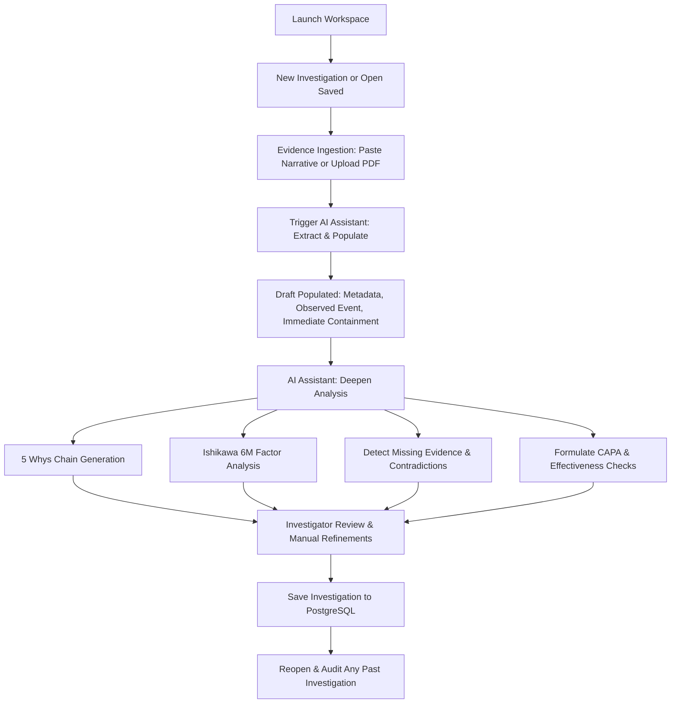

# TraceRoot: Functional & Technical Requirements Specification

## 1. Project Overview
**TraceRoot** is an AI-assisted Root Cause Analysis (RCA) workspace specifically tailored for Active Pharmaceutical Ingredient (API) manufacturing deviation investigations. It enables Quality Assurance (QA), Technical Services, and Process Engineering investigators to rapidly ingest unstructured deviation narratives (PDF reports, operator shift logs, emails), extract critical manufacturing context into structured drafts, generate structured root-cause hypotheses (5 Whys and 6M Ishikawa analysis), surface evidentiary contradictions or missing data, and construct ICH Q10-aligned CAPA and effectiveness check plans.

---

## 2. Mandatory Tech Stack & Architecture

| Layer | Technology | Role / Responsibility |
|---|---|---|
| **Frontend Framework** | React 18 + TypeScript | Type-safe, componentized single-page application |
| **State Management** | Redux Toolkit (RTK) | Manages active investigation draft, dirty states, AI streaming/progress, 5 Whys chain, and CAPA matrix |
| **Styling & UI** | Vanilla CSS / CSS Modules | Clean, responsive design system tailored for pharmaceutical auditability and high visual hierarchy |
| **Backend Framework** | Python 3.12 + FastAPI | Asynchronous REST API, typed Pydantic v2 schemas, lifecycle management |
| **Orchestration & AI** | LangGraph + Groq | Multi-step agent graph for context extraction, 5 Whys, Ishikawa analysis, missing evidence gap detection, and CAPA generation |
| **Database & ORM** | PostgreSQL 16 + SQLAlchemy 2.0 (Async) | Normalized schema for Investigations, Evidence Attachments, 5 Whys steps, Ishikawa factors, CAPA items |
| **Migrations** | Alembic | Schema version control and reversible database migrations |

---

## 3. Scope Boundaries

### In Scope
- Comprehensive RCA Investigation Workspace.
- Multi-format evidence ingestion:
  - Text input (pasted deviation narratives, shift logs, email chains).
  - PDF document upload (direct text extraction from manufacturing deviation summaries / lab OOS reports).
- AI Copilot Panel:
  - Single-click "Extract & Populate RCA Draft" workflow.
  - Step-by-step interactive actions: 5 Whys reasoning chain, 6M Fishbone classification, Evidence gap detector, CAPA generator.
- Interactive Investigator Editing:
  - Full inline editing of all AI-generated fields (Observed Event, Immediate Containment, 5 Whys steps, Contributing Factors, CAPAs, Effectiveness Checks).
  - Explicit distinction between Supporting vs. Contradictory evidence.
- State Persistence:
  - Save, list, reopen, and delete investigations with full fidelity in PostgreSQL.
- Realistic API Manufacturing Sample Datasets.

### Out of Scope (Explicitly Excluded per Assessment Spec)
- Standalone Deviation Management / CAPA tracking enterprise modules outside the RCA workspace.
- Customer Complaints and Change Control modules.
- Live email inbox polling / SMTP IMAP integrations.
- Heavy OCR engines (standard PDF text parsing only).
- Enterprise SSO / OAuth2 / multi-tenancy.
- Vector databases / embeddings-based RAG.
- Autonomous unmonitored agent loops executing without human investigator confirmation.

---

## 4. End-to-End User Journey

---

## 5. Non-Functional Requirements
- **Explainability**: Clear domain terminology (e.g., Critical Process Parameters [CPPs], Critical Quality Attributes [CQAs], Out-of-Specification [OOS]).
- **Reliability & Offline Graceful Degradation**: If Groq API key is omitted or network is unavailable, system gracefully transitions to a high-fidelity deterministic heuristic extraction engine based on pharmaceutical deviation taxonomy.
- **Data Integrity**: Auditable timestamps, clean foreign key relationships, cascade deletes, and transaction isolation.
